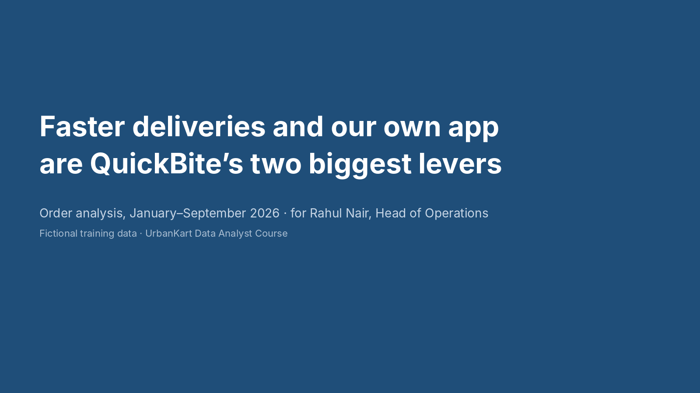

# QuickBite: Delivery Speed, Ratings and Platform Economics

**Food-delivery analysis of 24,000+ orders (Jan–Aug 2026) across 6 cloud kitchens in Bengaluru, Mumbai and Hyderabad.**



## 1. Business problem
QuickBite's Head of Operations asked three questions:
1. Why are customer ratings falling in some kitchens?
2. Which ordering platform is most profitable per order?
3. Where should we act first?

## 2. Data
| File | Rows | Description |
|---|---|---|
| orders_2026-01 … 08.csv | 24,355 | One row per order (9 monthly files, 3 date formats) |
| platforms.csv | 3 | Commission % per platform |

Data is synthetic (created for training) but modelled on real food-delivery patterns.

## 3. Approach
- **Cleaning (Python, pandas):** combined 9 files, removed 355 duplicates, parsed 3 date formats, fixed city names and missing ratings
- **Analysis:** revenue trend, delivery time vs rating, platform net value, kitchen comparison
- **SQL:** monthly KPIs and kitchen ranking queries (`sql/`)
- **Dashboard:** Power BI, 2 pages (`dashboard/`)

## 4. Key findings
- Revenue grew **37%** (₹9.22 L in Jan → ₹12.64 L in Aug)
- Ratings fall sharply after **35 minutes** (4.54 → 3.21 stars); 51% of orders take longer
- The own app keeps **96%** of order value vs ~70–74% on aggregator apps
- Madhapur (Hyderabad) orders fell **33%** from June: a kitchen issue, not a city issue

## 5. Recommendations
1. Pilot a 35-minute delivery promise in Andheri and Madhapur
2. Add evening riders in the two slowest kitchens
3. Shift 10% of orders to the own app (≈ ₹2 L/year net gain)

## 6. Repository structure
```
data/        raw and cleaned data
notebooks/   01_cleaning.ipynb, 02_analysis.ipynb
sql/         kpi_queries.sql
dashboard/   QuickBite.pbix + screenshots
reports/     QuickBite_Story_Deck.pdf (8 slides)
images/      charts used in this README
```

## 7. How to run
```
pip install -r requirements.txt
jupyter notebook notebooks/01_cleaning.ipynb
```

## 8. Tools
Python (pandas, matplotlib) · SQL (MySQL) · Power BI · Excel

## 9. Author
**Priya Sharma** · Data Analyst · [LinkedIn](https://www.linkedin.com/in/your-profile) · priya.analyst@example.com
